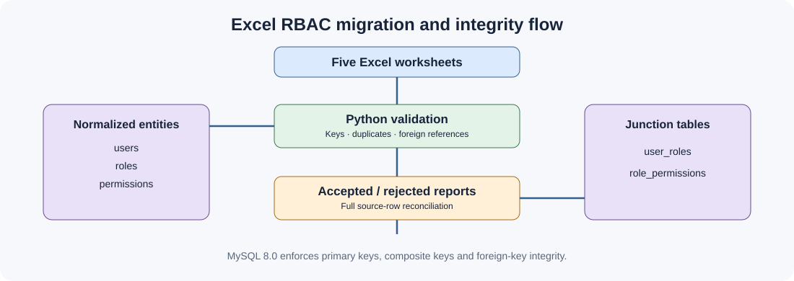
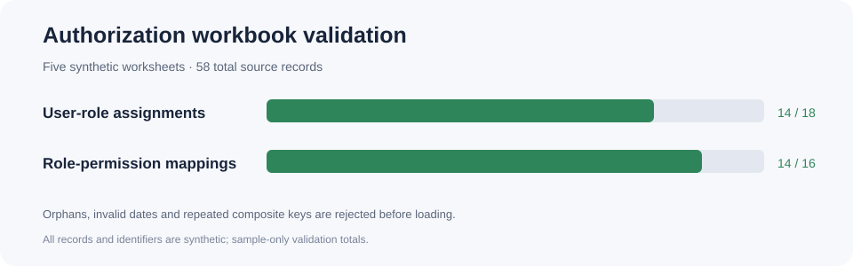

# Excel to SQL: Roles & Permissions Migration

[](https://github.com/agustiininicabral/excel-to-sql-roles-permissions/actions/workflows/ci.yml)

A reproducible portfolio practice project migrating a multi-sheet Excel workbook into a normalized **MySQL 8.0** authorization model. It demonstrates relational modeling, primary and foreign keys, many-to-many relationships, referential-integrity checks, duplicate detection, and transactional loading.

> Educational project. All users, roles, permissions, and assignments are synthetic. It is not an authorization product or production migration service.

## Data model

- `users`: source user directory
- `roles`: available application roles
- `permissions`: resource/action capabilities
- `user_roles`: user-to-role assignments
- `role_permissions`: role-to-permission assignments

## Quick start

```bash
python -m venv .venv
# Windows: .venv\Scripts\activate
# macOS/Linux: source .venv/bin/activate
python -m pip install -r requirements.txt
python scripts/generate_sample_workbook.py
```

Validate the five sheets without connecting to MySQL:

```bash
PYTHONPATH=src python -m roles_migration.main --dry-run --input data/source/authorization_source.xlsx
```

Create the schema and run the load:

```bash
mysql -u root -p < sql/001_create_schema.sql
# Copy .env.example to .env and configure local credentials.
PYTHONPATH=src python -m roles_migration.main --input data/source/authorization_source.xlsx
```

## Visual overview





## Validation rules

- Unique user IDs, role codes, and permission codes.
- Required names, valid email addresses, and valid active flags.
- Every user-role assignment must reference an existing user and role.
- Every role-permission assignment must reference an existing role and permission.
- Duplicate many-to-many pairs are rejected.
- Assignment dates must parse correctly.
- All accepted rows are loaded in dependency order inside one transaction.

Run tests with `pytest`. CI starts an ephemeral MySQL 8.0 service, regenerates the workbook, runs tests and a dry-run, applies the schema, loads all five tables, verifies persisted counts and foreign-key integrity, and uploads validation reports. `scripts/apply_schema.py` and `scripts/verify_database.py` reproduce the database checks.

## Contents

`data/` synthetic multi-sheet workbook; `src/` transformation and loader; `sql/` normalized schema and audit queries; `tests/` unit and workbook tests; `docs/` ERD, dictionary, design and quality report.

## Limitations

The sample is intentionally small. This model illustrates RBAC-style assignments; it does not implement runtime authorization, policy evaluation, tenant isolation, or privilege escalation controls. Production role design requires security review and explicit least-privilege requirements.
